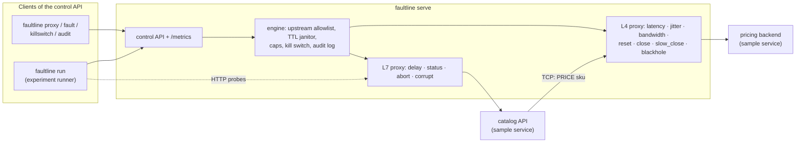

# faultline

**Fault-injecting TCP and HTTP proxies for the network paths between your
services, plus a chaos experiment runner that aborts on an SLO breach and
always rolls back.**

[](https://github.com/SlateGitOrg/faultline/actions/workflows/ci.yml)

## Why

Every service eventually meets a dependency that is slow, flaky, resetting
connections or returning garbage, and most code paths for those cases are
never exercised until production finds them. Tools that perturb the network
usually need root, `tc`/iptables or a container runtime, and few of them know
when to stop an experiment that is hurting more than expected. faultline is a
single static Go binary that sits in front of a dependency as an ordinary
proxy, injects those failures on demand, and runs YAML experiments whose
verdict is the process exit code, so the check can live in CI.

## Features

- **L4 (TCP) faults:** latency and jitter (without reordering bytes or
  throttling throughput), bandwidth caps, TCP resets, clean closes after N
  bytes, slow half-closes and blackholes.
- **L7 (HTTP) faults:** request delay, injected status codes with custom
  bodies and headers, aborted connections and corrupted response bodies (bit
  flips or truncation), matched by method, path prefix and request headers.
- **Blast-radius scoping:** per-fault probability decided once per
  connection or request, `max_affected` concurrency caps, source IP/CIDR
  scoping, and an upstream allowlist that defaults to loopback.
- **Faults always die:** a server-side TTL on every fault, a global kill
  switch, rollback on every exit path and a kill switch on daemon shutdown.
- **Experiment runner:** verify a steady-state hypothesis, run a timed fault
  schedule, watch probes, abort automatically when a significance-tested SLO
  breach is detected, roll back, check recovery, and write a JSON + Markdown
  report. Verdicts map to exit codes.
- **Control API + CLI:** a JSON HTTP API with bearer-token auth, a browser
  guard against CSRF and DNS rebinding, an audit log and Prometheus metrics
  at `/metrics`; the CLI and the runner are both clients of it.
- **Offline demo system:** a bundled two-hop sample service (catalog →
  pricing) and four experiments that end passed, falsified, aborted and
  staged-degraded.

No root, no iptables, no Docker; the only dependency beyond the standard
library is a YAML parser.

## Architecture



One process, `faultline serve`, owns every proxy and every guard rail. The
CLI and the experiment runner only talk to it over the control API, so the
same allowlist, TTL caps, kill switch and audit trail apply no matter who
injects a fault. Each proxy reads its fault set from a lock-free
copy-on-write registry on every TCP chunk or HTTP request.

The diagram also shows how the demo is wired: probes call the catalog
through the L7 proxy `edge`, and the catalog calls its pricing backend
through the L4 proxy `pricing` with a 250 ms timeout, so an L4 fault on the
back hop surfaces as user-visible errors and latency on the front hop.
[docs/ARCHITECTURE.md](docs/ARCHITECTURE.md) covers the data-plane
algorithms, the experiment state machine and complexity notes.

## Quick start

Prerequisites: Go 1.27 or newer, `make`, `bash` and `curl`. Linux or macOS;
everything runs on loopback without privileges.

```console
$ git clone https://github.com/SlateGitOrg/faultline.git && cd faultline
$ make build          # bin/faultline and bin/sampleservice
$ make test           # unit + loopback integration tests
$ make demo           # starts both binaries, runs the 4 bundled experiments, asserts each verdict
```

`make demo` uses loopback ports 17070 and 17100–17102 and writes reports to
`out/demo/<experiment>/report.{md,json}`.

To drive it by hand, start the daemon and the sample service (catalog on
:7100, which reaches pricing on :7101 through a proxy on :7102):

```console
$ bin/faultline serve &                                   # control API on 127.0.0.1:7070
$ bin/sampleservice --pricing-addr 127.0.0.1:7102 &
$ bin/faultline health --wait 10s
```

## Usage

Ad hoc: put a TCP proxy in front of pricing and slow it down for two
minutes. Output below is from a real run, trimmed only where marked.

```console
$ bin/faultline proxy create pricing --kind tcp --listen 127.0.0.1:7102 --upstream 127.0.0.1:7101
proxy pricing (tcp) listening on 127.0.0.1:7102 -> 127.0.0.1:7101

$ bin/faultline fault add pricing --type latency --latency 120ms --jitter 30ms --ttl 2m
fault pricing-latency-1 on pricing: latency 120ms±30ms downstream (expires 2026-10-26T05:13:50+05:30)

$ for i in 1 2 3; do curl -s -o /dev/null -w '%{http_code} %{time_total}s\n' http://127.0.0.1:7100/products/anvil; done
200 0.144765s
200 0.143966s
200 0.122902s

$ bin/faultline fault ls pricing
ID                 FAULT                          EXPIRES  APPLIED  AFFECTED NOW
pricing-latency-1  latency 120ms±30ms downstream  in 2m0s  3        0

$ bin/faultline killswitch on --reason "done"
kill switch ENGAGED: done (all faults removed; new faults refused)
```

Or run a whole experiment; it creates and removes its own proxies:

```console
$ bin/faultline killswitch off
kill switch released
$ bin/faultline proxy rm pricing
proxy pricing deleted
$ bin/faultline run experiments/03-pricing-outage-abort.yaml
# Experiment `pricing-outage-abort`: ABORTED

> A latency spike beyond the catalog's timeout trips the abort guard long before the 60s schedule ends.

| | |
|---|---|
| Verdict | **aborted** |
| Hypothesis during faults | deviated |
| Recovered after rollback | yes |
| Abort reason | abort condition breached over the last 1s: [catalog success_rate >= 0.800 (got 0.000 (0/4), 95% upper bound 0.403)] |
  [... timeline, injected faults and per-phase tables trimmed ...]
## Probe timeline
catalog         ▂▁▁▁▁▁▇▇█▇▇▁▁▁▁▁▁▁▁  peak p95 257ms
                      xxxxx
pricing-direct  ▁▁▁▁▁▁▇▇ █▁▁▁▁▁▁▁▁▁  peak p95 401.5ms

verdict: ABORTED (exit 3) in 4.606s
report: faultline-reports/pricing-outage-abort/report.md, faultline-reports/pricing-outage-abort/report.json
```

The 60-second outage was cut short about 1.1 s after injection, and the
catalog was back within its SLO right after rollback. `faultline audit`
prints every control-plane action of the session.

Commands: `serve`, `health`, `proxy ls|create|rm`, `fault ls|add|rm|clear`,
`killswitch on|off|status`, `audit`, `run`, `validate`, `version`
(`faultline <command> -h` for flags). Client commands read
`FAULTLINE_CONTROL` and `FAULTLINE_TOKEN` (see [.env.example](.env.example)).

An experiment, abridged (full reference in
[docs/EXPERIMENTS.md](docs/EXPERIMENTS.md)):

```yaml
name: pricing-outage-abort
control: ${FAULTLINE_CONTROL:-127.0.0.1:7070}
proxies:
  - {name: pricing, kind: tcp, listen: 127.0.0.1:7102, upstream: 127.0.0.1:7101}
  - {name: edge, kind: http, upstream: "http://127.0.0.1:7100"}
probes:
  - name: catalog
    http: {url: proxy://edge/products}
steady_state:
  duration: 1500ms
  interval: 50ms
  objectives:
    - {probe: catalog, min_success_rate: 0.95, max_p95: 200ms}
method:
  - name: pricing-latency-spike
    proxy: pricing
    duration: 60s
    faults: [{type: latency, latency: 400ms}]
abort:
  window: 1s
  min_samples: 4
  objectives:
    - {probe: catalog, min_success_rate: 0.8}
```

Exit codes: 0 passed, 2 failed (hypothesis falsified or not recovered),
3 aborted, 4 precondition failed, 1 error.

### The bundled experiments

What the method phase of each experiment observed in one `make demo` run
(from `out/demo/*/report.md`; timings and counts vary slightly between runs,
the verdicts are asserted by the demo script):

| Experiment | Faults | Method-phase result | Verdict |
|---|---|---|---|
| 01 pricing latency tolerated | L4 latency 60 ms ± 20 ms on pricing | catalog 44/44 ok, p95 83.2 ms (objective ≤ 200 ms) | passed |
| 02 edge errors falsified | L7 503 at p = 0.2 on `/products`, +20 ms on `/products/` | catalog 72.1 %, anvil 75.4 % success (objective ≥ 95 %; abort guard 50 % not breached) | failed |
| 03 pricing outage abort | L4 latency 400 ms (> catalog's 250 ms timeout) for 60 s | catalog 0/5 ok; abort after 1.1 s; recovered | aborted |
| 04 staged degradation | L4 reset p = 0.3 (max 2 concurrent), then L7 1 % bit flips | catalog 72.1 %: 503 ×12, body mismatch ×5 | failed |

## How it works

The full list of decisions with their trade-offs is in
[DECISIONS.md](DECISIONS.md). The ones that shape behaviour most:

- **Latency without throttling.** The L4 relay timestamps chunks on arrival
  and a separate writer releases each at `arrival + latency`, so a latency
  fault delays bytes without capping throughput. Jitter is clamped to the
  previous chunk's due time, so it never reorders a TCP stream.
- **Per-connection decisions.** Probability, source scope and
  `max_affected` are decided once per TCP connection: a 30 % reset fault
  resets about 30 % of connections, not 30 % of every connection's chunks.
- **O(flips) corruption.** Bit-flip corruption draws the gap to the next
  flipped byte from a geometric distribution instead of rolling per byte.
- **Abort on evidence, not noise.** A success-rate abort objective fails only
  when the one-sided 95 % Wilson upper bound of the observed rate is below
  the objective. With a plain point estimate, the demo's 20 %-error
  experiment aborted by chance (3 failures in the first 5 samples); with the
  bound, a hard outage still aborts after 4 samples (0/4 → upper bound 0.40).
- **Faults always die.** Server-side TTL on every fault (experiment TTLs are
  derived as step duration + grace), rollback on its own context after every
  outcome including Ctrl-C, and the kill switch engages on daemon shutdown.
- **Loopback by default.** Upstreams must resolve entirely inside an
  allowlist (default loopback) and TCP upstreams are pinned to the resolved
  IP; the daemon refuses a non-loopback listen address without a token, and
  proxies listen on loopback unless `--allow-public-listen` is given.
- **Not drivable from a browser.** The control API refuses requests with an
  `Origin` or cross-site `Sec-Fetch-Site` header, POSTs that are not
  `application/json`, and (without a token) any `Host` that is not loopback,
  so a web page cannot use CSRF or DNS rebinding to inject faults.

Blast-radius controls are described in
[docs/BLAST_RADIUS.md](docs/BLAST_RADIUS.md) and the threat model in
[docs/THREAT_MODEL.md](docs/THREAT_MODEL.md).

### Accuracy

`make bench` (`tools/latencybench`, about a minute; `make bench-quick` for a
short run) measures round trips through the proxies against in-process
loopback servers, with and without the fault, plus a bare `time.Timer` of
the same duration as a baseline for how late the host wakes a sleeping
goroutine. A full run on an 8-core arm64 Mac with other builds running:

| Layer | Configured | Samples | Median added | p99 added | Median error | Host timer overshoot |
|---|---:|---:|---:|---:|---:|---:|
| L4 tcp | 1 ms | 200 | 1.38 ms | 3.64 ms | +0.38 ms | +0.26 ms |
| L4 tcp | 10 ms | 200 | 12.16 ms | 13.11 ms | +2.16 ms | +2.02 ms |
| L4 tcp | 50 ms | 60 | 52.18 ms | 54.27 ms | +2.18 ms | +2.04 ms |
| L4 tcp | 250 ms | 30 | 252.28 ms | 252.36 ms | +2.28 ms | +2.04 ms |
| L7 http | 1 ms | 200 | 1.25 ms | 1.58 ms | +0.25 ms | +0.26 ms |
| L7 http | 10 ms | 200 | 12.20 ms | 14.42 ms | +2.20 ms | +2.02 ms |
| L7 http | 50 ms | 60 | 52.55 ms | 54.21 ms | +2.55 ms | +2.04 ms |
| L7 http | 250 ms | 30 | 252.96 ms | 253.90 ms | +2.96 ms | +2.04 ms |

(The full table also covers 0, 5, 25 and 100 ms.) The error is almost
entirely the host's timer overshoot (macOS coalesces timers by about 2 ms):
net of it, the median residual is between 0.0 and 0.9 ms across the full
table. Jitter of 50 ms ± 20 ms produced a standard deviation of 11.06 ms
against the 11.55 ms of a uniform distribution. Bandwidth caps of 16 KiB/s
to 1 MiB/s were met within −0.1 % to +1.2 %. With no faults, the TCP proxy
added about 39 µs to the median loopback round trip (16 µs direct, 55 µs
proxied) and relayed bulk echo traffic at 1222 MB/s (1912 MB/s direct).

The same properties are asserted, with tolerances suited to a loaded CI
machine, by `TestLatencyAccuracy`, `TestLatencyBothDirectionsAndJitterOrdering`
and `TestBandwidthAccuracy` (`internal/tcpproxy`) and `TestDelayAccuracy`
(`internal/httpproxy`).

## Testing

```console
$ make test     # go test -count=1 ./...
$ make check    # gofmt/goimports check, go build + go vet, golangci-lint,
                # the full suite under -race, and an 80 % coverage gate on internal/...
```

`make check` is exactly what CI runs ([.github/workflows/ci.yml](.github/workflows/ci.yml)),
followed by `make demo`. It needs `golangci-lint` v2 on the `PATH` (CI
installs v2.14.0). Coverage from `./scripts/coverage.sh` in a local
`make check` run:

```text
internal/cli             95.4%  (438/459 statements)
internal/control         98.4%  (249/253 statements)
internal/engine          98.6%  (278/282 statements)
internal/experiment      94.1%  (479/509 statements)
internal/fault           98.6%  (279/283 statements)
internal/httpproxy       96.5%  (136/141 statements)
internal/probe           96.5%  (139/144 statements)
internal/report          95.9%  (116/121 statements)
internal/sample          96.7%  (119/123 statements)
internal/slo             97.9%  (95/97 statements)
internal/tcpproxy        92.9%  (223/240 statements)
TOTAL                    96.2%  (2551/2652 statements)
```

The 106 test functions cover unit behaviour, loopback integration tests for
every fault type, the experiment runner against the real control API and
sample service (abort on breach, rollback on interrupt, refused injections,
precondition failure), property checks (percentiles, Wilson bounds,
corruption rates), the browser guard, and a golden-file test for the
Markdown report.

## Project layout

```text
cmd/faultline        CLI entry point          internal/engine      proxies + policy
cmd/sampleservice    demo system binary       internal/control     JSON API, metrics, client
internal/fault       fault model + registry   internal/probe       steady-state probes
internal/tcpproxy    L4 proxy                 internal/slo         stats, objectives, Wilson bound
internal/httpproxy   L7 proxy                 internal/experiment  YAML spec + runner
internal/report      JSON/Markdown reports    internal/cli         all commands
internal/sample      demo pricing + catalog   tools/latencybench   accuracy benchmark
experiments/         bundled experiments      scripts/             demo + coverage scripts
docs/                architecture, experiment reference, blast radius, threat model
```

## Limitations

faultline is a lab and staging tool. It does not intercept traffic: a client
only goes through it if you point the client at the proxy's address.

- **User-space proxy, not netem.** No packet loss, duplication, reordering
  or MTU effects; TCP retransmission behaviour is never exercised.
- **Timer-bound accuracy.** Injected latency is accurate to the host's timer
  resolution (about +2 ms on macOS, see Accuracy); sub-millisecond latency
  injection is not meaningful.
- **No TLS interception.** The L7 proxy listens on plain HTTP (it can talk
  HTTPS to an upstream). HTTPS clients need the L4 proxy, which cannot
  inject HTTP-level faults.
- **HTTP/1.1 focus.** `abort` on HTTP/2 becomes a stream reset; gRPC-aware
  faults (status codes in trailers) are not implemented.
- **Single node, in-memory state.** Proxies, faults and the audit log live in
  one process and are lost on restart (faults are cleared on shutdown by
  design); there is no clustering or agent fleet.
- **One shared bearer token** and no TLS on the control API. Without a token,
  any local process or user on the machine can drive the daemon; the
  browser guard only stops web pages.
- **Simple probes.** HTTP and TCP request/response probes only; no
  Prometheus queries or tracing as steady-state sources.
- **Small-sample statistics.** Steady-state checks use point estimates over
  the observation window, so short windows with few samples can flip a
  verdict. Only the abort path is significance-tested.
- **Synthetic numbers.** Every measurement here comes from loopback traffic
  on one machine against the bundled sample service.

Possible next steps: an optional Linux `tc netem` backend for packet-level
faults, Prometheus-backed steady-state probes, gRPC-aware L7 faults with TLS
termination, persisting the audit log and active faults across restarts, and
ramped faults.

## License

MIT — see [LICENSE](LICENSE).
