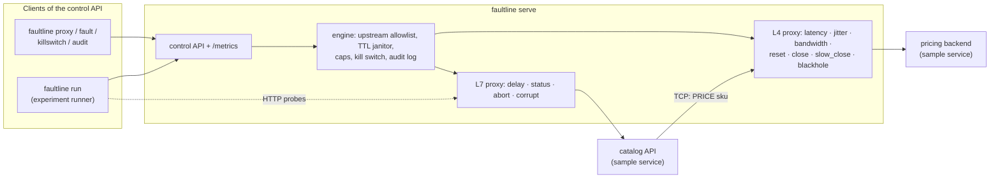

# faultline

**Fault injection for the network paths between your services, plus a chaos
experiment runner that knows when to stop.**

faultline puts an L4 (TCP) or L7 (HTTP) proxy between a client and a
dependency and injects the failures that dependency will eventually produce:
latency and jitter, bandwidth limits, resets, abrupt and slow closes,
blackholes, injected HTTP status codes, aborted requests and corrupted
response bodies. A small control API manages the proxies and faults. On top
of it, `faultline run` executes chaos experiments written in YAML: verify a
steady-state hypothesis, apply a fault schedule, watch SLO probes, **abort
automatically on an SLO breach**, roll back, verify recovery and write a
JSON + Markdown report whose verdict is the process exit code.

Single static Go binary, no dependencies beyond a YAML parser, no root, no
iptables, no Docker.

## Who it is for

- Service owners who want to know what their code does when a dependency
  gets slow or flaky *before* production finds out, and want that check in
  CI (verdict → exit code).
- Platform/SRE teams running game days in staging who need hard guard
  rails: allowlisted targets, TTLs on every fault, significance-tested
  abort conditions, a kill switch and an audit trail.
- Anyone learning chaos engineering: the bundled sample service and four
  experiments show a passed, a falsified, an aborted and a staged
  multi-fault experiment end to end, offline.

It is a lab and staging tool. It does not intercept traffic: a client only
goes through faultline if you point it at the proxy's address.

## Architecture



The demo wires the bundled sample system exactly like this: probes call the
catalog through the L7 proxy `edge`, and the catalog calls its pricing
backend through the L4 proxy `pricing` with a 250 ms timeout, so an L4 fault
on the back hop surfaces as user-visible errors and latency on the front
hop. See [docs/ARCHITECTURE.md](docs/ARCHITECTURE.md) for the data-plane
algorithms (timestamped chunk relay, non-reordering jitter, pacer, geometric
bit-flip sampling), the experiment state machine and complexity notes.

## Quickstart

Requires Go 1.27.

```console
$ make build                      # bin/faultline, bin/sampleservice
$ bin/faultline serve &           # control API on 127.0.0.1:7070, loopback upstreams only
$ bin/sampleservice --pricing-addr 127.0.0.1:7102 &   # catalog :7100 -> (proxy :7102) -> pricing :7101

# Ad hoc: put a proxy in front of pricing and slow it down for 2 minutes.
$ bin/faultline proxy create pricing --kind tcp --listen 127.0.0.1:7102 --upstream 127.0.0.1:7101
$ bin/faultline fault add pricing --type latency --latency 120ms --jitter 30ms --ttl 2m
$ curl -s -w ' %{http_code} %{time_total}s\n' http://127.0.0.1:7100/products/anvil
$ bin/faultline fault ls pricing
$ bin/faultline killswitch on --reason "done"     # removes every fault, refuses new ones

# Or run a whole experiment (the experiment creates and removes its proxies):
$ bin/faultline killswitch off
$ bin/faultline proxy rm pricing
$ bin/faultline run experiments/03-pricing-outage-abort.yaml
```

Commands: `serve`, `health`, `proxy ls|create|rm`, `fault ls|add|rm|clear`,
`killswitch on|off|status`, `audit`, `run`, `validate`, `version`
(`faultline <command> -h` for flags). Client commands read
`FAULTLINE_CONTROL` and `FAULTLINE_TOKEN` (see `.env.example`).

An experiment, abridged ([full reference](docs/EXPERIMENTS.md)):

```yaml
name: pricing-outage-abort
control: ${FAULTLINE_CONTROL:-127.0.0.1:7070}
proxies:
  - {name: pricing, kind: tcp, listen: 127.0.0.1:7102, upstream: 127.0.0.1:7101}
  - {name: edge, kind: http, upstream: "http://127.0.0.1:7100"}
probes:
  - name: catalog
    http: {url: proxy://edge/products}
steady_state:
  duration: 1500ms
  interval: 50ms
  objectives:
    - {probe: catalog, min_success_rate: 0.95, max_p95: 200ms}
method:
  - name: pricing-latency-spike
    proxy: pricing
    duration: 60s
    faults: [{type: latency, latency: 400ms}]
abort:
  window: 1s
  min_samples: 4
  objectives:
    - {probe: catalog, min_success_rate: 0.8}
```

## Demo

`make demo` builds both binaries, starts them on loopback ports
17070/17100–17102, validates and runs the four bundled experiments, and
fails unless each one reaches its expected verdict. Output of a real run
(abridged where marked):

```text
$ make demo
http://127.0.0.1:17070: ok (version 0.1.0, 0 proxies, killswitch false)

== validate ==
ok   experiments/01-pricing-latency-tolerated.yaml: "pricing-latency-tolerated", 1 probe(s), 1 step(s), 1 fault(s), schedule 3s, abort objectives 1
ok   experiments/02-edge-errors-falsified.yaml: "edge-errors-falsified", 2 probe(s), 1 step(s), 2 fault(s), schedule 3s, abort objectives 1
ok   experiments/03-pricing-outage-abort.yaml: "pricing-outage-abort", 2 probe(s), 1 step(s), 1 fault(s), schedule 1m0s, abort objectives 1
ok   experiments/04-staged-degradation.yaml: "staged-degradation", 1 probe(s), 2 step(s), 2 fault(s), schedule 3s, abort objectives 1

== run 01-pricing-latency-tolerated ==
verdict: PASSED (exit 0) in 6.007s
== run 02-edge-errors-falsified ==
verdict: FAILED (exit 2) in 6.015s
== run 03-pricing-outage-abort ==
verdict: ABORTED (exit 3) in 4.61s
== run 04-staged-degradation ==
verdict: FAILED (exit 2) in 6.005s

== abort experiment report (03-pricing-outage-abort) ==
# Experiment `pricing-outage-abort`: ABORTED
| Verdict | **aborted** |
| Hypothesis during faults | deviated |
| Recovered after rollback | yes |
| Abort reason | abort condition breached over the last 1s: [catalog success_rate >= 0.800 (got 0.000 (0/4), 95% upper bound 0.403)] |

## Timeline
| t+1.504s | precondition | steady state verified |
| t+1.504s | inject | step pricing-latency-spike: pricing-latency-4 on pricing (latency 400ms, ttl 1m5s) |
| t+2.606s | abort | ABORT: abort condition breached over the last 1s: [...] |
| t+2.607s | remove | pricing-latency-4 removed from pricing (rollback) |
| t+4.61s | recovery | steady state restored after rollback |
  [... phases table abridged ...]

## Probe timeline
catalog         ▁▁▁▁▁▁█▇▇▇▇▁▁▁▁▁▁▁▁  peak p95 258.1ms
                      xxxxx
pricing-direct  ▁▁▁▁▁▁▇▇ █▁▁▁▁▁▁▁▁▁  peak p95 403.3ms

== summary ==
01-pricing-latency-tolerated     verdict=passed   exit=0 expected=0 ok
02-edge-errors-falsified         verdict=failed   exit=2 expected=2 ok
03-pricing-outage-abort          verdict=aborted  exit=3 expected=3 ok
04-staged-degradation            verdict=failed   exit=2 expected=2 ok
```

The 60-second outage was cut short **1.1 s** after injection and the system
was back within its SLO immediately after rollback. What the method phase of
each experiment observed in that run (from `out/demo/*/report.md`):

| Experiment | Faults | Method-phase result | Verdict |
|---|---|---|---|
| 01 pricing latency tolerated | L4 latency 60 ms ± 20 ms on pricing | catalog 44/44 ok, p95 83.2 ms (objective ≤ 200 ms) | passed |
| 02 edge errors falsified | L7 503 at p = 0.2 on `/products`, +20 ms on `/products/` | catalog 72.1 %, anvil 75.4 % success (objective ≥ 95 %; abort guard 50 % not breached) | failed |
| 03 pricing outage abort | L4 latency 400 ms (> catalog's 250 ms timeout) for 60 s | catalog 0/5 ok; abort after 1.1 s; recovered | aborted |
| 04 staged degradation | L4 reset p = 0.3 (max 2 concurrent), then L7 1 % bit flips | catalog 72.1 %: 503 ×12, body mismatch ×5 | failed |

Timings and counts vary slightly between runs; the verdicts are asserted by
the demo script.

## Accuracy

Injected latency is measured by `make bench` (`tools/latencybench`):
round trips through the proxies against in-process loopback servers, with
and without the fault, plus a bare `time.Timer` of the same duration as a
baseline for how late the host wakes a sleeping goroutine. Real run on an
8-core arm64 Mac while other builds were running:

| Layer | Configured | Samples | Median added | p99 added | Median error | Host timer overshoot |
|---|---:|---:|---:|---:|---:|---:|
| L4 tcp | 1 ms | 200 | 1.38 ms | 3.64 ms | +0.38 ms | +0.26 ms |
| L4 tcp | 10 ms | 200 | 12.16 ms | 13.11 ms | +2.16 ms | +2.02 ms |
| L4 tcp | 50 ms | 60 | 52.18 ms | 54.27 ms | +2.18 ms | +2.04 ms |
| L4 tcp | 250 ms | 30 | 252.28 ms | 252.36 ms | +2.28 ms | +2.04 ms |
| L7 http | 1 ms | 200 | 1.25 ms | 1.58 ms | +0.25 ms | +0.26 ms |
| L7 http | 10 ms | 200 | 12.20 ms | 14.42 ms | +2.20 ms | +2.02 ms |
| L7 http | 50 ms | 60 | 52.55 ms | 54.21 ms | +2.55 ms | +2.04 ms |
| L7 http | 250 ms | 30 | 252.96 ms | 253.90 ms | +2.96 ms | +2.04 ms |

(The full table also covers 0, 5, 25 and 100 ms.) The error is almost
entirely the host's timer overshoot (macOS coalesces timers by about 2 ms):
net of it, the median residual is between 0.0 and 0.9 ms across all
rows of the full table. Jitter of 50 ms ± 20 ms produced a
standard deviation of 11.06 ms against the 11.55 ms of a uniform
distribution. Bandwidth caps of 16 KiB/s to 1 MiB/s were met within
−0.1 % to +1.2 %. With no faults, the TCP proxy added about 39 µs to the
median loopback round trip (16 µs direct, 55 µs proxied) and relayed bulk
echo traffic at 1222 MB/s (1912 MB/s direct).

The same properties are asserted, with tolerances suited to a loaded CI
machine, by integration tests: `TestLatencyAccuracy`,
`TestLatencyBothDirectionsAndJitterOrdering`, `TestBandwidthAccuracy`
(`internal/tcpproxy`), `TestDelayAccuracy` (`internal/httpproxy`).

## Quality gate

`make check` = gofmt/goimports check, `go build` + `go vet`,
golangci-lint (zero issues, config in `.golangci.yml`), the full test suite
under `-race`, and a coverage gate of 80 % on `internal/...`. The same gate
runs in `.github/workflows/ci.yml` (not yet executed: the repository has
not been pushed), followed by `make demo`.

Coverage from `./scripts/coverage.sh` (run by `make check`):

```text
internal/cli             95.6%  (451/472 statements)
internal/control         98.3%  (229/233 statements)
internal/engine          98.5%  (270/274 statements)
internal/experiment      94.6%  (524/554 statements)
internal/fault           98.5%  (267/271 statements)
internal/httpproxy       96.6%  (143/148 statements)
internal/probe           96.5%  (139/144 statements)
internal/report          96.1%  (122/127 statements)
internal/sample          96.7%  (119/123 statements)
internal/slo             97.9%  (95/97 statements)
internal/tcpproxy        93.8%  (243/259 statements)
TOTAL                    96.3%  (2602/2702 statements)
```

102 test functions (`grep -h '^func Test' internal/*/*_test.go | wc -l`)
across unit tests, loopback integration tests for every fault type, the
experiment runner against the real control API and sample service
(abort-on-breach, rollback on interrupt, refused injections, precondition
failure), property checks (percentiles, Wilson bounds, corruption rates),
and a golden-file test for the Markdown report.

## Design decisions

The full list with trade-offs is in [DECISIONS.md](DECISIONS.md). The ones
that shape behaviour most:

- **Latency without throttling.** The L4 relay timestamps chunks on arrival
  and releases each at `arrival + latency`, so a latency fault delays bytes
  without capping throughput; jitter is clamped so it never reorders bytes.
- **Per-connection decisions.** Probability, source scope and
  `max_affected` are decided once per TCP connection: a 30 % reset fault
  resets about 30 % of connections, not 30 % of every connection's chunks.
- **Abort on evidence, not noise.** Success-rate abort objectives fail when
  the one-sided 95 % Wilson upper bound of the observed rate is below the
  objective. Without it, the demo's 20 %-error experiment aborted by chance
  (3 failures in the first 5 samples); with it, a hard outage still aborts
  after 4 samples.
- **Faults always die.** Server-side TTL on every fault, derived TTLs in
  experiments, rollback on every exit path, kill switch on daemon shutdown.
- **Loopback by default.** Upstream allowlist with DNS pinning; the daemon
  refuses a non-loopback listen address without a token.

Blast-radius controls are documented in
[docs/BLAST_RADIUS.md](docs/BLAST_RADIUS.md) and the threat model in
[docs/THREAT_MODEL.md](docs/THREAT_MODEL.md).

## Limitations

- **User-space proxy, not netem.** No packet loss, duplication, reordering
  or MTU effects; TCP retransmission behaviour is never exercised. Faults
  only affect traffic that is explicitly routed through a proxy.
- **Timer-bound accuracy.** Injected latency is accurate to the host's
  timer resolution (about +2 ms on macOS, see Accuracy); sub-millisecond
  latency injection is not meaningful.
- **No TLS interception.** The L7 proxy listens on plain HTTP (it can talk
  HTTPS to an upstream). HTTPS clients need the L4 proxy, which cannot
  inject HTTP-level faults.
- **HTTP/1.1 focus.** `abort` on HTTP/2 becomes a stream reset; gRPC-aware
  faults (status codes in trailers) are not implemented.
- **Single node, in-memory state.** Proxies, faults and the audit log live
  in one process and are lost on restart (faults are cleared on shutdown by
  design); there is no clustering or agent fleet.
- **Auth is one shared bearer token** without TLS on the control API.
- **Probes are simple.** HTTP and TCP request/response probes only; there is
  no integration with Prometheus queries or tracing as steady-state sources.
- **Small-sample statistics.** Steady-state checks use point estimates over
  the observation window; short windows with few samples can flip a verdict.
  Only the abort path is significance-tested.
- **Everything measured here is synthetic.** All numbers come from loopback
  traffic on one machine against the bundled sample service; nothing has
  been run against a production system.

## Roadmap

- Packet-level faults via an optional Linux `tc netem` backend.
- Steady-state probes backed by Prometheus queries.
- gRPC-aware L7 faults and TLS termination for the L7 proxy.
- Persisting the audit log and active faults (with TTLs) across restarts.
- Ramped faults (latency that grows over a step) and step dependencies.

## Repository layout

```text
cmd/faultline        CLI entry point          internal/engine      proxies + policy
cmd/sampleservice    demo system binary       internal/control     JSON API, metrics, client
internal/fault       fault model + registry   internal/probe       steady-state probes
internal/tcpproxy    L4 proxy                 internal/slo         stats, objectives, Wilson bound
internal/httpproxy   L7 proxy                 internal/experiment  YAML spec + runner
internal/report      JSON/Markdown reports    internal/cli         all commands
internal/sample      demo pricing + catalog   tools/latencybench   accuracy benchmark
experiments/         bundled experiments      scripts/             demo + coverage scripts
```

Size: 6,375 lines of non-test Go (5,396 excluding comments and blank
lines) and 3,540 lines of tests
(`find internal cmd tools -name '*.go' ! -name '*_test.go' | xargs wc -l`).

## License

MIT, see [LICENSE](LICENSE).
