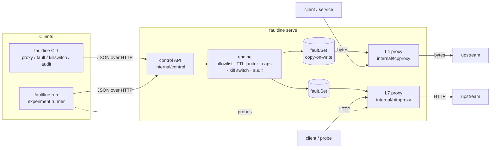
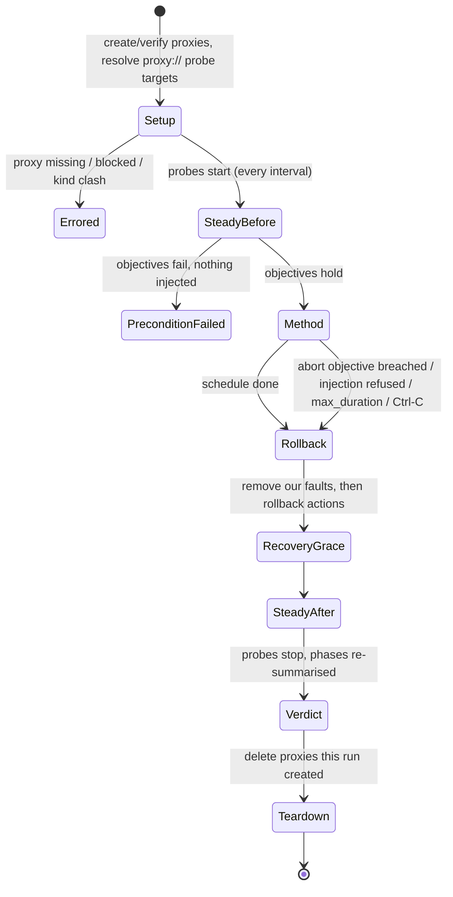

# Architecture

faultline has three layers: **data plane** (the L4 and L7 proxies that
actually perturb traffic), **control plane** (the engine that owns proxies,
faults and every guard rail, exposed as a JSON API), and **experiments**
(a client of the control plane that turns a YAML hypothesis into a fault
schedule, watches SLOs, aborts, rolls back and reports).



## Package map

| Package | Responsibility |
|---|---|
| `internal/fault` | Fault spec model and validation, `Duration` JSON type, seeded RNG, the lock-free `Set` registry with TTLs and blast-radius slots, the per-connection `Decider`. |
| `internal/tcpproxy` | L4 relay: latency, jitter, bandwidth, reset, close, slow close, blackhole. |
| `internal/httpproxy` | L7 reverse proxy: delay, status, abort, body corruption (flip / truncate). |
| `internal/engine` | Proxy lifecycle and all policy: upstream allowlist + pinning, TTL cap and janitor, proxy/fault caps, kill switch, audit ring. |
| `internal/control` | JSON HTTP API over the engine, bearer auth, Prometheus metrics, and the Go client. |
| `internal/probe` | HTTP and TCP steady-state probes, error classification, the phase-aware sample recorder. |
| `internal/slo` | Summaries (success rate, nearest-rank percentiles), objectives, significance-tested abort checks, timeline buckets. |
| `internal/experiment` | YAML spec + validation + env expansion, and the runner state machine. |
| `internal/report` | Report model, verdict → exit code, JSON and Markdown rendering with sparklines. |
| `internal/sample` | The bundled demo system (TCP pricing backend, HTTP catalog API). |
| `internal/cli` | All CLI commands (`serve`, `proxy`, `fault`, `killswitch`, `audit`, `run`, `validate`, `health`). |
| `cmd/faultline`, `cmd/sampleservice` | Thin `main` packages. |
| `tools/latencybench` | Accuracy benchmark for injected latency, jitter, delay and bandwidth. |

## Data plane

### Fault registry (`fault.Set`)

Proxies consult the registry on every TCP chunk and every HTTP request,
while writes (add/remove/sweep) happen a few times per experiment. The set
is therefore an immutable slice behind an `atomic.Pointer`: reads are one
atomic load and no lock; writes take a mutex, copy the slice and swap it.
`Live(now)` filters expired faults without allocating in the common case
(nothing expired). Expired faults stop applying the instant their TTL
passes; the engine's janitor sweeps them from the set every 250 ms and
audits the expiry.

Each `Active` fault carries two atomic counters: `applied` (total) and
`affected` (current). `Acquire`/`Release` implement `max_affected` with a
CAS loop, so the cap holds under concurrent connections without a lock.

### L4: the TCP relay

Each accepted connection is a `session` with two pipes (upstream:
client→server, downstream: server→client). A pipe is two goroutines:

```text
src ──read──▶ [reader] ──chunk{data, arrivedAt}──▶ queue (64) ──▶ [writer] ──write──▶ dst
                                                                     │
                                       plan(now): delay, rate, closeAfter, blackhole, slowClose
```

- **Latency without throttling.** The reader stamps each chunk with its
  arrival time; the writer sleeps until `arrivedAt + latency` and writes.
  Because chunks keep arriving while the writer sleeps, a 100 ms fault adds
  100 ms to every byte but does not cap throughput at one chunk per 100 ms.
  The bounded queue (64 × 32 KiB) provides back-pressure like a link buffer.
- **Jitter without reordering.** Each chunk's due time is
  `max(arrivedAt + latency ± U(jitter), previousDue)`; TCP is ordered, so
  jitter may bunch chunks but never reorder them.
- **Bandwidth.** A pacer writes slices of `rate/20` bytes (≥ 256) and
  schedules the next slice at `n / rate` seconds later. It does not
  accumulate credit while idle, so a quiet connection cannot burst.
- **Reset.** `SO_LINGER=0` then close sends an RST to the client (and the
  upstream). `delay: 0` resets on accept, before the upstream is dialled;
  otherwise a timer is armed per session. Reset faults added mid-connection
  are armed on the next chunk.
- **Close / slow close / blackhole.** `close` writes up to `after_bytes` in
  the fault's direction and then FINs both sides; `slow_close` holds the
  propagation of a half-close for `delay`; `blackhole` discards data while
  the connection stays open (the client sees a hang, not an error).
- **Per-connection decisions.** A `Decider` memoises, per (session, fault),
  the outcome of the source check, the probability roll and the
  `max_affected` slot. A 30 % reset fault therefore resets 30 % of
  connections (measured 70/200 = 35 % in `TestResetProbabilityAndCap`), and
  a latency fault never affects half of a connection's bytes. Slots are
  released when the session ends.

Complexity per chunk: O(F) for F live faults on the proxy (planning is a
linear scan; F ≤ 32 by default). Memory per connection: bounded by the two
queues, at most 2 × 64 × 32 KiB.

### L7: the HTTP reverse proxy

`httputil.ReverseProxy` with `Rewrite` (sets `X-Forwarded-*`). For each
request, `selectFaults` returns the live faults that match
(source, methods, path prefix, headers), pass their probability roll and
get a `max_affected` slot. Effects apply in a fixed order:

1. **delay**: sum of the delays of all matching delay faults (with jitter);
   cancelled if the client goes away;
2. **abort**: hijack the connection and RST it (HTTP/2: stream reset);
3. **status**: answer with the first status fault's code, body and headers
   without contacting the upstream;
4. **forward**, wrapping the response body for each **corrupt** fault.

Bit-flip corruption chooses each byte independently with probability `rate`,
but instead of rolling per byte it draws the gap to the next flipped byte
from a geometric distribution, `gap = ⌊ln U / ln(1−p)⌋`, so the cost is
O(number of flips). Truncation stops the stream after `after_bytes`; with a
`Content-Length` the client observes an unexpected EOF, which is exactly
what a connection dropped mid-body looks like.

Every faulted response carries `X-Faultline-Fault: <ids>`.

## Control plane

### Engine

`engine.Engine` owns the proxies (`map[name]*entry`, mutex-guarded) and is
the only place policy lives:

- **Upstream allowlist.** Resolve the upstream host; every address must be
  inside `AllowUpstreams` (default loopback). TCP upstreams are rewritten to
  the resolved IP (pinning).
- **TTL.** Faults without a TTL get `MaxTTL`; larger TTLs are refused.
- **Caps.** `MaxProxies`, `MaxFaultsPerProxy`.
- **Kill switch.** Engaging it sets a flag and clears every set. `AddFault`
  checks the flag before installing and again after installing (removing the
  fault if the switch was engaged concurrently), so no fault survives a race
  with the switch.
- **Audit.** A 512-entry ring buffer of events with monotonically increasing
  sequence numbers; `Events(since)` supports incremental tailing.

Errors are sentinel-wrapped (`ErrInvalid`, `ErrBlocked`, `ErrKillSwitch`,
`ErrNotFound`, `ErrExists`) and the API maps them to 400/403/423/404/409.

### Control API

| Method | Path | Purpose |
|---|---|---|
| GET | `/v1/health` | Liveness (unauthenticated). |
| GET, POST | `/v1/proxies` | List / create proxies. |
| GET, DELETE | `/v1/proxies/{name}` | Describe (faults + counters) / delete. |
| GET, POST, DELETE | `/v1/proxies/{name}/faults` | List / add / clear faults. |
| DELETE | `/v1/proxies/{name}/faults/{id}` | Remove one fault. |
| DELETE | `/v1/faults` | Clear every fault on every proxy. |
| GET, POST | `/v1/killswitch` | Read / engage / release. |
| GET | `/v1/audit?since=N` | Audit events after sequence N. |
| GET | `/metrics` | Prometheus text format counters. |

Request bodies are decoded with unknown fields rejected and capped at 1 MiB.
With a token configured, every endpoint except health requires
`Authorization: Bearer <token>` (constant-time comparison).

Before routing, every request passes a browser guard: a request with an
`Origin` header or a `Sec-Fetch-Site` other than `none` gets `403`, a POST
whose `Content-Type` is not `application/json` gets `415`, and, when no
token is configured, a request whose `Host` is not a loopback IP or
`localhost` gets `421` (DNS rebinding). The CLI, the experiment runner and
curl pass all three checks unchanged. See THREAT_MODEL T9.

## Experiments

### Lifecycle



Verdict precedence: `aborted` (an abort reason was recorded) >
`error` (any control or rollback error) > `failed` (hypothesis deviated
during the method, or steady state not restored afterwards) > `passed`.
Exit codes: 0 passed, 2 failed, 3 aborted, 4 precondition failed, 1 error.

### Fault schedule

Each step runs in its own goroutine: sleep until `start + at`, install its
faults with TTL `duration + fault_ttl_grace`, sleep `duration`, remove them.
Installation calls use a context detached from the abort cancellation
(`context.WithoutCancel`) so that a fault the server installed is always
known to the runner and therefore always rolled back. An injection that the
engine refuses (policy, kill switch) aborts the run.

### Sampling and phase attribution

Probes run concurrently, one goroutine per probe, on a ticker; a probe slower
than the interval skips ticks instead of piling up. The recorder labels each
sample with the phase that was current when the probe **started**, and also
records the phase current when it completed. A sample that started in
`steady-state-before` and completed during `method` overlapped the faults
and is attributed to the method. After the run the probes are stopped and
every phase is re-summarised, so in-flight probes are counted where they
belong.

### Abort monitor

Every `check_every`, for each abort objective:

1. take the probe's method samples since `now − window`, extended back to the
   last `min_samples` samples if the window holds fewer (prevents starvation
   when probes time out);
2. skip if fewer than `min_samples` exist;
3. evaluate latency thresholds on point percentiles, and success-rate
   thresholds on the one-sided Wilson upper bound at `confidence` (default
   0.95):

   ```text
   p = s/n,  z = Φ⁻¹(confidence)
   upper = (p + z²/2n + z·sqrt(p(1−p)/n + z²/4n²)) / (1 + z²/n)
   breach ⇔ upper < min_success_rate
   ```

   0/4 successes give an upper bound of 0.40 (aborts against 0.8); 2/5
   give 0.73 (does not abort against 0.5).

The first breach records the failing checks, cancels the schedule, and
rollback runs.

Complexity: each check is O(S log S) for S samples of the probe (selection
is a linear scan of the recorder plus a sort for percentiles). For the
default probe interval of 200 ms and runs of minutes, S is in the hundreds.

### Summaries and percentiles

`slo.Summarize` is O(n log n): sort latencies once, nearest-rank
percentiles (`idx = ⌈p·n⌉ − 1`). Failed samples are included in latency
percentiles (a request that timed out after 1 s was a 1 s request for its
caller). Timeline buckets slice the run into at most 60 columns and render
p95 per bucket as a sparkline with an error marker row.

## Concurrency and shutdown

- Proxies track their sessions/servers and `Close` tears down every open
  connection and waits for all goroutines (tests run with `-race`).
- `faultline serve` on SIGINT/SIGTERM: engage kill switch → graceful HTTP
  shutdown (5 s) → close all proxies.
- `faultline run` on SIGINT/SIGTERM: the run context is cancelled, the
  method stops, rollback and teardown run on their own contexts, and the
  report records `aborted: interrupted`.
