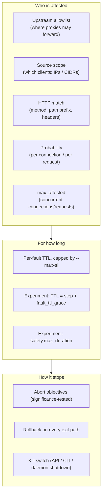

# Blast-radius controls

A fault injector is only useful if you can trust it to break *exactly* what
you asked for, for *exactly* as long as you asked, and to stop when told.
faultline layers its controls so that each one still holds when the layer
above it fails: the experiment runner can crash, the CLI can be killed, the
operator can forget — the daemon still enforces TTLs, and the daemon's
shutdown still clears every fault.



## 1. Where traffic can go: the upstream allowlist

`faultline serve` only creates proxies whose upstream resolves *entirely*
inside `--allow-upstream` (default `127.0.0.0/8,::1/128`).

- Every resolved address must be allowed, not just one, so a name with a
  loopback and a public record is refused.
- TCP upstreams are pinned to the resolved IP when the proxy is created; a
  later DNS change cannot redirect the proxy.
- Refusals are `403 Forbidden` and land in the audit log as `proxy.reject`.

```console
$ faultline proxy create evil --upstream 203.0.113.7:80
faultline proxy: control API: 403 Forbidden: blocked by blast-radius policy: upstream 203.0.113.7 (203.0.113.7) is outside the allowlist [127.0.0.0/8 ::1/128]; widen it with --allow-upstream
```

Widen it deliberately for a staging network: `faultline serve --allow-upstream 10.20.0.0/16`.

Proxies themselves also listen on loopback only. A proxy whose `listen`
address is not a loopback IP or `localhost` (for example `0.0.0.0:7102`,
`:7102` or a LAN address) is refused with `403` unless the daemon runs with
`--allow-public-listen`. Without this rule, a proxy to a loopback-only
upstream (a local database, say) would publish that service to the network,
and the loopback-only allowlist would not stop it, because loopback is
exactly what it allows.

## 2. Who is affected: per-fault scope

| Control | Field | Applies to | Semantics |
|---|---|---|---|
| Source scope | `sources: [10.1.2.3, 10.9.0.0/16]` | tcp, http | Only clients whose address is inside the list. Empty = everyone. |
| Request match | `match: {methods, path_prefix, headers}` | http | All set fields must match (AND); any listed method may match. |
| Probability | `probability: 0.2` | tcp, http | TCP: decided **once per connection** (a 20 % fault breaks 20 % of connections, not 20 % of every connection's packets). HTTP: per request. Omitted means 1; an explicit `0` is honoured (the fault never applies), never widened to 1. |
| Concurrency cap | `max_affected: 3` | tcp, http | At most N connections/requests are affected *at the same time*; slots are released when they finish. |
| Direction | `direction: upstream\|downstream\|both` | tcp | Which half of the stream the fault acts on. |

A canary-style fault that only hits requests carrying a header, at most two
at a time:

```yaml
- type: status
  status: 503
  match: {headers: {X-Chaos: "on"}}
  max_affected: 2
```

## 3. How long: TTLs everywhere

- Every fault has a server-side TTL. A fault submitted without one gets
  `--max-ttl` (default 30 min); a longer TTL is refused (`403`).
- A background sweeper removes expired faults every 250 ms and records
  `fault.expire` in the audit log; expired-but-not-yet-swept faults are
  already ignored by the proxies.
- In experiments the TTL is not user-settable: it is `step.duration +
  safety.fault_ttl_grace` (default 10 s). If the runner process dies
  mid-step, the daemon removes the fault shortly after it was due to end.
- `safety.max_duration` (default 10 min) bounds the whole fault schedule; a
  schedule longer than it is rejected at validation time, and the runner
  enforces it with a deadline as well.

## 4. When to stop: abort conditions

Abort objectives are evaluated every `abort.check_every` over a sliding
`abort.window` during the fault schedule. When one is breached the runner
records the breach, removes its faults immediately and still verifies
recovery afterwards.

Two details keep this trustworthy:

- **Significance, not noise.** A success-rate abort objective fails only
  when the one-sided Wilson upper bound (default 95 %, `abort.confidence`)
  of the observed success rate is below the objective. A hard outage (0 of 4
  samples against 0.8) aborts within a handful of samples; 2 failures out of
  5 under a 20 % fault does not.
- **No starvation.** When probes time out they take longer than the probe
  interval, so the time window is extended back to the most recent
  `abort.min_samples` samples. An outage cannot hide from its own abort
  check by slowing probes down.

The precondition is a control too: if the steady-state hypothesis does not
hold *before* injection, nothing is injected (`precondition_failed`, exit 4).

## 5. Rollback on every exit path

The runner removes every fault it installed after completion, abort, step
failure, safety timeout and Ctrl-C (SIGINT/SIGTERM), on a separate 15 s
context that the cancellation cannot reach. User-declared rollback actions
(`clear_faults: <proxy>|"*"`, `http:` hooks) run afterwards. Proxies the
experiment created are deleted at teardown; pre-existing ones are left alone.

## 6. The big red button: kill switch

```console
$ faultline killswitch on --reason "pager: checkout latency"
kill switch ENGAGED: pager: checkout latency (all faults removed; new faults refused)
```

Engaging the kill switch removes every fault on every proxy and refuses new
ones (`423 Locked`) until it is released. Fault creation re-checks the
switch after installing, so a fault racing the switch is removed. The
daemon engages it itself on shutdown, so stopping `faultline serve` is
always a full rollback.

## 7. Global caps and accountability

- `--max-proxies` (default 64) and `--max-faults` per proxy (default 32).
- Every change, rejection, expiry and kill-switch action is in the audit
  log (`faultline audit`, `GET /v1/audit?since=N`).
- Every HTTP response a fault touched carries `X-Faultline-Fault: <ids>`.
- `GET /metrics` exposes per-proxy counters (faulted requests, resets,
  dropped bytes) and `faultline_killswitch_engaged`.

## Checklist before pointing faultline at a shared environment

1. Run `faultline serve` with `FAULTLINE_TOKEN` set; it refuses a
   non-loopback `--listen` without one. Even on loopback, a token is the
   only protection against other local users and processes (see
   THREAT_MODEL T9).
2. Set `--allow-upstream` to the narrowest CIDR that contains the target,
   and add `--allow-public-listen` only if clients on other hosts must
   reach the proxies.
3. Lower `--max-ttl` to the longest experiment you intend to run.
4. Give every experiment abort objectives, and scope faults with `match`,
   `sources` and `max_affected`.
5. `faultline validate` the experiment; check its schedule length.
6. Know the kill switch command before you start.
